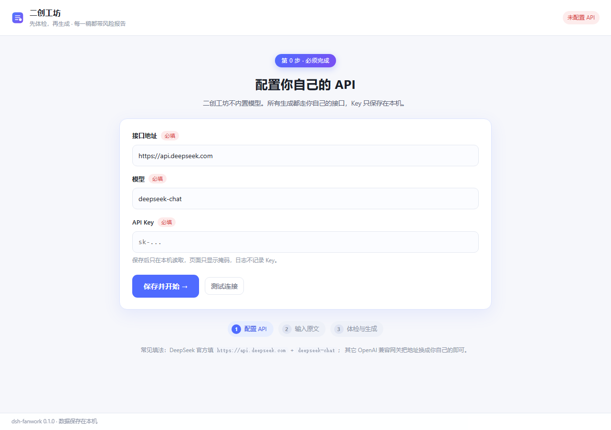

# 二创工坊 · dsh-fanwork

> 先给原文做逻辑体检，再在人的裁决下生成二创 —— 每一稿都自带风险报告。

A [DeepSeek Harness](https://github.com/deepseek-ai/deepseek-harness) plugin. It turns "ask a model to write fan fiction" into a
reviewable pipeline: structural digest → logic-risk report → human decisions → parallel drafts → per-draft audit → export.
Bring your own OpenAI-compatible API key; the plugin ships no model and no quota.



界面在 `http://127.0.0.1:<DSH 端口>/fanwork`，或在 DSH 里输入 `/fanwork` 取当前地址。

---

## 目录

- [它解决什么问题](#它解决什么问题)
- [安装](#安装)
- [开始使用](#开始使用)
- [工作流](#工作流)
- [配置](#配置)
- [隐私与密钥](#隐私与密钥)
- [常见问题](#常见问题)
- [HTTP 接口](#http-接口)
- [开发](#开发)
- [给插件作者的 DSH 踩坑记录](#给插件作者的-dsh-踩坑记录)

---

## 它解决什么问题

同人作者真正贵的不是「写」，而是「改写得不崩」：设定冲突、人物 OOC、伏笔失收，重写一遍才发现哪里不自洽。
二创工坊把这件事拆成可裁决的步骤——每条风险都带**原文引证**和**修复选项**，用户的每次选择进入决策台账，
再作为约束注入生成；每篇候选稿都由独立提示词的「审稿人」给出六维评分与问题清单。

## 安装

### 方式 A：从插件市场安装（推荐）

在 DeepSeek Harness 里打开 **设置 → 插件**，搜索 `dsh-fanwork`，点安装，按提示重启。
装好后 `/fanwork` 路由自动挂载，不需要改任何配置文件。

### 方式 B：命令行

```sh
dsh plugin --profile <你的 profile> add dsh-fanwork
```

装完重启 DSH。

### 方式 C：本地开发（link 到源码目录）

```powershell
node dsh-fanwork/scripts/install-profile.mjs desktop
```

脚本会在 profile 的 `node_modules` 下建 junction，并把 `dsh-fanwork` 写进 `dependencies` 与
`dsh.profile.bundles`（原 `package.json` 会备份）。之后重启 DSH。

### 卸载

```powershell
dsh plugin --profile <profile> remove dsh-fanwork
# 本地 link 装的：node dsh-fanwork/scripts/install-profile.mjs desktop --uninstall
```

## 开始使用

**需要准备：** 一个 OpenAI 兼容的接口地址 + 你自己的 API Key。
插件**不内置模型、不带额度**，未配置时所有生成类接口直接返回 `403 NOT_CONFIGURED`。

1. 打开 `http://127.0.0.1:<DSH 端口>/fanwork`（端口每次启动可能变化，用 `/fanwork` 命令取当前地址）。
2. **第 0 步 · 配置 API**：填接口地址（如 `https://api.deepseek.com`）、模型名（如 `deepseek-chat`）、你的 Key，
   点「保存并开始」。页面上有「测试连接」可以先验证一次。
3. **导入原文**（三种任选）：拖 `.txt` / `.md` 进虚线框；点「选择文件」；或填**本地路径**让插件在本机读
   （支持 `~`，≤ 4 MB）——文件不进浏览器、不上传。
4. 填创作要求（方向、篇幅、视角、风格、禁忌、补充要求），点「开始体检」。
5. **逐条裁决**风险：选一个修复方案，或展开「更多要求」直接写你想怎么改。
6. 点「应用裁决并生成」，并行出 2–3 篇立意不同的候选，每篇附六维审核报告。
7. 不满意就在「更多要求」里继续提，点「按新要求换一批」；满意就「采用此稿」。
8. 导出：项目目录下的 `export.md`（正文 + 风险报告附录 + 决策台账）。

## 工作流

```
原文 + 创作要求
      │
      ▼
 ① 骨架抽取  ── 人物 / 设定 / 时间线 / 事件 / 伏笔（长文分块并发）
      │
      ▼
 ② 风险体检  ── 4 族 17 类，每条带原文引证；无引证不成立
      │
      ▼
 ③ 用户裁决  ── 选方案，或写「更多要求」
      │
      ▼
 ④ 多稿生成  ── 并行 2–3 稿，立意不同（正面推进 / 侧面切片 / 反向假设）
      │
      ▼
 ⑤ 六维审核  ── 原作一致性 · 人物保真 · 内部逻辑 · 需求覆盖 · 合规 · 文笔
      │
      └── 不满意 →「更多要求」→ 回到 ④
      │
      ▼
 ⑥ 定稿导出  ── Markdown，附六维评分与问题清单
```

风险分类法（节选，完整 4 族 17 类见 `lib/prompts.js`）：

| 族 | 编号 | 类别 | 判定问题 |
|---|---|---|---|
| 冲突 | C1 | 设定冲突 | 同一规则或能力是否被两次不同地陈述 |
| 冲突 | C2 | 时间冲突 | 事件先后、年龄、季节能否同时成立 |
| 缺口 | G1 | 动机缺口 | 关键行为是否有与其分量匹配的铺垫 |
| 缺口 | G3 | 信息缺口 | 角色是否知道了按设定不该知道的事 |
| 结构 | S1 | 伏笔失收 | 已埋伏笔是否被遗忘或突兀回收 |
| 结构 | S4 | 结局未闭合 | 主线提出的问题是否被回答 |
| 体验 | E1 | OOC | 行为是否偏离人物既定性格与关系 |
| 体验 | E4 | 合规风险 | 是否触及版权、敏感内容或平台规则 |

## 配置

在插件行（或 profile 的 `cordis.patch.yml`，`id: fanwork`）里改 `config:`：

| 字段 | 默认值 | 含义 |
|---|---|---|
| `candidates` | `3` | 每次生成几稿（1–4） |
| `concurrency` | `4` | 长文分块解析的并发数（1–6） |
| `reasoningEffort` | `low` | 推理强度。**长文本请保持 low**，否则推理会吃光 token 预算 |
| `callTimeoutMs` | `600000` | 单次模型调用超时（毫秒） |
| `dataDir` | `~/.dsh/fanwork` | 项目数据目录 |

接口地址 / 模型名 / Key **不在配置里**，只能由使用者在页面上填，保存在 `<dataDir>/settings.json`（权限 `0600`）。

### 长文本行为

- 原文 ≤ 1.2 万字：一次调用抽骨架。
- 原文 > 1.2 万字：按 1.2 万字切块，并发解析后合并去重。
- 体检阶段对 > 1 万字的原文按段落均匀采样（保留原句，引证仍可定位），页面上会标注"采样"。

实测（4.2 万字原文、2 篇候选、800 字目标篇幅）：骨架 4 块并发 ≈ 70 s，体检 ≈ 70–110 s，整段 ≈ 2.5–3 分钟。
2 万字以内体验最好；再长建议分卷。

## 隐私与密钥

- **Key 只在本机**：写在 `<dataDir>/settings.json`（`0600`），只在服务端发请求时读取。
- **页面只显示掩码**（`sk-1****abcd`），日志里不写 Key，也不会回传到任何第三方。
- **不做遥测**：项目数据只落本机 `~/.dsh/fanwork/projects/<id>/`，不上传。
- 卸载插件不会删除你的数据；要彻底清理，手动删掉 `~/.dsh/fanwork`。
- 二创请自行确认原文使用权；导出文件已附原作信息与二创声明。

## 常见问题

**打开页面提示「未配置 API」/ 接口 403**
插件启动时是未配置状态。先完成第 0 步，或在顶部 API 状态条点「修改」重填并「测试连接」。

**端口变了，收藏的地址打不开**
DSH 每次启动端口可能不同。在输入框输入 `/fanwork` 取当前地址；插件也会把当前地址写到
`<dataDir>/last-url.txt`。

**体检很久没反应**
先看 `<dataDir>/fanwork.log`（一行一个 JSON，记录每次调用的耗时与 token）。常见原因是
`reasoningEffort` 太高导致推理吃光预算——保持 `low`。

**换模型 / 换网关**
点顶部 API 状态条「修改」，三格都可以改；保存后立即生效，不需要重启。

## HTTP 接口

| 方法 | 路径 | 用途 |
|---|---|---|
| GET | `/fanwork` | 工作台页面 |
| GET | `/fanwork/api/health` | 健康检查（含当前地址与配置状态） |
| GET / POST | `/fanwork/api/settings` | 读取（Key 已掩码）/ 保存 `{baseUrl, model, apiKey}` |
| POST | `/fanwork/api/settings/test` | 用当前设置发一次真实调用 |
| POST | `/fanwork/api/read-file` | 读本地文本 `{path}`（.txt/.md，≤ 4 MB） |
| GET | `/fanwork/api/projects` | 项目列表 |
| POST | `/fanwork/api/projects` | 新建项目 `{source, brief}` |
| GET | `/fanwork/api/projects/:id` | 项目快照 |
| POST | `/fanwork/api/projects/:id/run` | 执行阶段 `{stage: analyze\|generate\|regate}`，返回 SSE |
| POST | `/fanwork/api/projects/:id/decisions` | 提交裁决 |
| POST | `/fanwork/api/projects/:id/select` | 选定稿件并导出 |
| POST | `/fanwork/api/projects/:id/cancel` | 取消正在跑的阶段 |

SSE 事件：`stage` / `progress` / `canon` / `diagnose` / `delta` / `draft` / `audit` / `decisions` / `done` / `error`。
长调用期间服务端每 15 秒发一次注释心跳。

## 开发

```powershell
node scripts/dev-server.mjs                       # 本机假接口 + 自动指向它，http://127.0.0.1:7788/fanwork
$env:DEEPSEEK_API_KEY="sk-..."; node scripts/dev-server.mjs   # 连真实 API
node scripts/e2e-test.mjs http://127.0.0.1:7788   # 端到端冒烟
node scripts/plugin-check.mjs                     # 插件契约检查（假 ctx）
```

```
lib/
  index.js     插件入口（name / inject / apply；无 export default）
  service.js   阶段编排、SSE、取消、快照
  pipeline.js  流水线 + 归一化
  llm.js       JSON 抽取、修复重试
  remote-llm.js OpenAI 兼容流式客户端
  settings.js  本机设置（settings.json，0600）
  prompts.js   分类法、提示词、输出解析
  store.js     项目落盘（原子写）
  http.js      路由 / 静态资源 / SSE
  web/         工作台（原生 ESM，零构建）
```

Host 半改完需要触发一次重载（改 patch 行 id 或重启）；`lib/web/*` 改完刷新浏览器即可。

## 给插件作者的 DSH 踩坑记录

1. **不要 `export default`**：Loader 的 `unwrapExports` 会折叠模块并丢掉 `inject`。
2. **不要手写 assistant 消息**：`ctx.llm.stream({messages})` 里的 assistant 消息必须带 `source`，
   自己拼一个 `{role:'assistant'}` 会抛 `Cannot read properties of undefined (reading 'replayState')`。
3. **没有结构化输出参数**：`GenerateOptions` 只有 temperature / maxTokens / stop，
   JSON 靠提示词 + 括号抽取 + 校验 + 修复重试。
4. **推理会吃 token 预算**：推理型模型可能把 maxTokens 全花在思考上导致正文为空，表现出来是「JSON 解析失败」。
5. **`link:` 安装拿不到 profile 依赖**：Node 的 ESM 解析从真实路径向上找，插件里不要 import `@deepseek-ai/*`。
6. **长调用要心跳**：1–2 分钟没有事件的 SSE 连接会被中间层掐断。
7. **bundle patch 的行 id 要和 profile 覆写用的 id 一致**，否则同一插件会被注册两次。

## License

MIT
